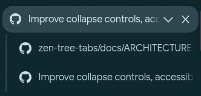
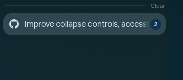

# Zen Tree Tabs

Sidebery-style **tree tabs** built into [Zen Browser](https://zen-browser.app)'s own sidebar — no extension, no second tab list. Tabs nest under the tab they were opened from, subtrees collapse, and drag & drop lets you pick the nesting depth.

It's a userChrome.js mod (loaded with [fx-autoconfig](https://github.com/MrOtherGuy/fx-autoconfig)), so it works on Zen's real tab strip and plays along with spaces, split views, pinned tabs and folders.

## Screenshots

### Expanded tree



### Collapsed tree



## Features

- **Automatic nesting** — tabs opened from a link become children of that tab.
- **New tabs (Ctrl+T)** open after the current tab's entire subtree, as its next sibling (configurable: sibling / child / end).
- **Indentation & guide lines** — uses Zen's native indent (same step as its folders) plus thin per-level lines.
- **Collapse / expand** — a separate chevron beside the close/reset button toggles a parent's subtree without replacing its favicon or selecting an unrelated tab. If collapsing would hide the selected tab, the collapsed parent is selected instead. Collapsed parents show a hidden-row count, including on hover (a split counts as one row). Selecting a hidden tab (Ctrl+Tab, search…) expands its branch.
- **Drag & drop with depth picking** — the drop line shows where the tab lands and at what level; drag sideways to nest deeper or pull out. The future parent is highlighted (or the space header, for a top-level drop). Subtrees move along with their root.
- **Split views are tree nodes** — a split nests, has children, and drags as one unit. Drag-onto-a-tab splitting still works (hover a tab's middle).
- **Pinned tabs have their own tree** per space. Pinning/unpinning a tab moves its whole subtree; dragging between the pinned and normal trees lets you pick a valid nesting depth.
- **Closing a parent** moves its children up one level. Closing one tab of a split keeps its children under the remaining split tab(s).
- **Persistent** — the tree survives restarts and "undo close tab" (stored via SessionStore).

Zen's own folders and Essentials are left alone.

## Install

Requirements: Zen Browser (development baseline: **1.22.3b**, Firefox 156 base), Bash and Git. `install.sh` targets Linux; other OSes need manual fx-autoconfig setup and the equivalent profile files.

```sh
git clone https://github.com/iamfnd/zen-tree-tabs.git
cd zen-tree-tabs
./install.sh                      # or: ./install.sh "/path/to/zen/profile"
```

Profile auto-detection reads `~/.zen/installs.ini`. For other profile locations, pass the profile's **Root Directory** from `about:profiles` explicitly. Keep this checkout in place: the installed JS and CSS are symlinks into it.

The script:

1. clones fx-autoconfig into `vendor/` unless it's already present,
2. copies its loader files into your profile's `chrome/utils/`,
3. symlinks `src/zen-tree-tabs.uc.js` → `chrome/JS/` and `src/zen-tree-tabs.css` → `chrome/resources/`,
4. if `/opt/zen-browser-bin/config.js` is missing, prints two `sudo cp` commands for the one-time program-side loader (`config.js` and `defaults/pref/config-prefs.js`). Run those yourself, adjusting the destinations if Zen is installed elsewhere. An existing `config.js` only skips this message; the script does not verify that both fx-autoconfig loader files are installed.

Restart Zen. In the Browser Console (Ctrl+Shift+J) you should see `[zen-tree-tabs] loaded, script saved …`. If nothing loads on the very first install, use **about:support → Clear startup cache…** once.

> A Zen update may replace its program directory. If the mod stops loading after an update, re-run the two `sudo cp` commands.

## Usage

| Action | How |
|---|---|
| Nest a tab | Open it from a link, or drag it and move the pointer **right** (one indent ≈ one level) |
| Un-nest | Drag and move the pointer **left** |
| Collapse / expand | With the sidebar expanded, hover a parent, then click its chevron beside the close/reset button (also revealed on keyboard focus; Enter / Space toggles) |
| Move a whole branch | Drag its root tab |
| Pin a branch | Pin its root (context menu or drag into the pinned area) |
| Make a split | Drag a tab onto the middle of another tab and hold briefly |
| Reload the mod | **Ctrl+Alt+Shift+R** (picks up JS and CSS edits in the current window, no restart) |

## Settings (`about:config`)

| Pref | Type | Default | Meaning |
|---|---|---|---|
| `zen-tree-tabs.newtab-position` | string | `sibling` | Where Ctrl+T / new-tab-button tabs go: `sibling` (after the current tab's entire subtree, same level), `child` (last child of the current tab), `end` (leave placement to Zen) |
| `zen-tree-tabs.block-tab-split` | bool | `false` | Disable Zen's drag-onto-a-tab split view while dragging tree tabs, unless `zen.splitView.enable-drag-over-split` has an explicit user value |
| `zen-tree-tabs.debug` | bool | `false` | Log drag/drop and tree decisions to the Browser Console (takes effect immediately) |

Create a pref with the **+** button if it doesn't exist yet.

If `newtab-position` is unset or invalid, the legacy boolean `zen-tree-tabs.newtab-as-child` is still consulted: `false` means `end`; `true` or unset means `sibling`. Set a valid `newtab-position` to override it.

Look & feel lives in `src/zen-tree-tabs.css` (`--ztt-guide-width`, `--ztt-guide-color`, badge style…). The indent step is `INDENT_PX` in the script.

## Development

- Edit files in `src/` — they're symlinked into the profile — then press **Ctrl+Alt+Shift+R** in each open Zen window.
- `node tests/scenarios.mjs` requires Node.js and runs the tree logic against a mocked tab strip (no browser needed). It prints trees for nesting, drag/drop, splits, pinned tabs, new-tab placement, session restoration and inactive spaces. Collapse clicks have visibility and selection assertions; the other scenarios print output for inspection. Native layout and keyboard activation still need a live Zen check.
- How it works and which Zen internals it relies on: [docs/ARCHITECTURE.md](docs/ARCHITECTURE.md).

## Known limitations

- Relies on Zen/Firefox internals (see the architecture doc); a Zen update can break it.
- Tabs inside Zen folders, Essentials, Glance and Zen's empty tab are not part of the tree.
- Links and Ctrl+T from a pinned tab open normal tabs, which aren't nested (they're in the other section).
- Multi-selected tabs (other than the tabs of one split) are dragged by Zen without tree handling.
- Tree drag previews only apply within the active space and need another tree node in the target section. Expand a collapsed branch before dropping children into it. Cross-space drags and drops over or beside folders are left to Zen.
- Pinning a branch pins its tabs one by one, which can take a moment for large branches.

## License

[MIT](LICENSE)
